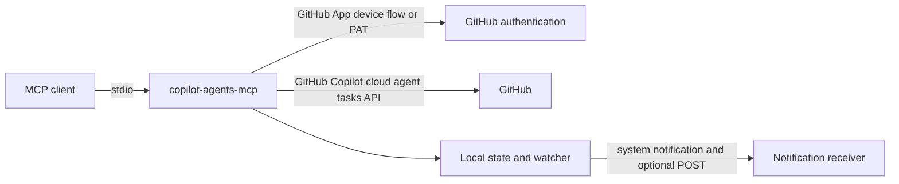

<p align="center">
  
</p>

# copilot-agents-mcp

`copilot-agents-mcp` is a local Model Context Protocol (MCP) server for launching and managing GitHub Copilot cloud agent tasks.
It runs on your machine over stdio or local HTTP. Version 0.0.1 requires Node.js 26 or later.



## Install

The package is not published to npm. Run it directly from this repository:

```bash
npx -y github:daniel-saezv/copilot-agents-mcp
```

The default server uses stdio. To use local HTTP, run:

```bash
npx -y github:daniel-saezv/copilot-agents-mcp --http --port 3333
```

The HTTP endpoint is `http://127.0.0.1:3333/mcp`.

## Authentication

Use one of these credential modes:

- **Personal access token.** Set `GITHUB_PERSONAL_ACCESS_TOKEN` in the MCP process environment.
- **GitHub App.** Run `npx -y github:daniel-saezv/copilot-agents-mcp login`, complete the device flow, and leave `GITHUB_PERSONAL_ACCESS_TOKEN` unset.

Check the active credential with:

```bash
npx -y github:daniel-saezv/copilot-agents-mcp auth status
```

See [authentication](docs/authentication.md) and [permissions](docs/permissions.md).

## Configure your MCP client

Every example below has two variants:

- PAT: keep the `env` block and do not run `login`.
- GitHub App: run `login`, then remove the `env` block.

The command is the same in each client. Replace `github_pat_...` with a token that has the required permissions.

### Visual Studio Code

Create `.vscode/mcp.json`:

```json
{
  "servers": {
    "copilot-agents": {
      "type": "stdio",
      "command": "npx",
      "args": ["-y", "github:daniel-saezv/copilot-agents-mcp"],
      "env": {
        "GITHUB_PERSONAL_ACCESS_TOKEN": "github_pat_..."
      }
    }
  }
}
```

For GitHub App authentication, run `login` once and remove the `env` property.

### Claude Desktop

Add this server to `claude_desktop_config.json`:

```json
{
  "mcpServers": {
    "copilot-agents": {
      "command": "npx",
      "args": ["-y", "github:daniel-saezv/copilot-agents-mcp"],
      "env": {
        "GITHUB_PERSONAL_ACCESS_TOKEN": "github_pat_..."
      }
    }
  }
}
```

For GitHub App authentication, run `login` once and remove the `env` property.

### Claude Code

For a PAT, register the local stdio server:

```bash
claude mcp add --transport stdio copilot-agents \
  -e GITHUB_PERSONAL_ACCESS_TOKEN=github_pat_... \
  -- npx -y github:daniel-saezv/copilot-agents-mcp
```

For GitHub App authentication, run the server `login` command first. Then register it without `-e`:

```bash
npx -y github:daniel-saezv/copilot-agents-mcp login
claude mcp add --transport stdio copilot-agents \
  -- npx -y github:daniel-saezv/copilot-agents-mcp
```

### Cursor

Create `.cursor/mcp.json`:

```json
{
  "mcpServers": {
    "copilot-agents": {
      "command": "npx",
      "args": ["-y", "github:daniel-saezv/copilot-agents-mcp"],
      "env": {
        "GITHUB_PERSONAL_ACCESS_TOKEN": "github_pat_..."
      }
    }
  }
}
```

For GitHub App authentication, run `login` once and remove the `env` property.

### Grok Bot

Configure Grok Bot as a local MCP server over stdio with:

```json
{
  "mcpServers": {
    "copilot-agents": {
      "command": "npx",
      "args": ["-y", "github:daniel-saezv/copilot-agents-mcp"],
      "env": {
        "GITHUB_PERSONAL_ACCESS_TOKEN": "github_pat_..."
      }
    }
  }
}
```

For GitHub App authentication, run `login` once and remove the `env` property.

## Tools

<!-- START AUTOMATED TOOLS -->
| Tool | Toolset | Read-only | Description |
| --- | --- | --- | --- |
| `create_agent_task` | copilot_tasks | no | Launch a GitHub Copilot cloud agent task. The model is sent unchanged. If the model was already rejected, the tool skips the API call and lists accepted models observed so far. |
| `get_agent_task` | copilot_tasks | yes | Read a GitHub Copilot agent task once. |
| `steer_agent_task` | copilot_tasks | no | [Experimental] Undocumented internal GitHub endpoint that can change without notice. Each steer consumes credits. The agent applies the instruction after its current tool call finishes. Send an instruction to a task with an open pull request. |
| `abort_agent_task` | copilot_tasks | no | [Experimental] Undocumented internal GitHub endpoint that can change without notice. Send {type: "abort"} to the steer endpoint, as VS Code does in tasksClient.ts, to stop the task. This has not been verified against GitHub. |
| `get_agent_task_events` | copilot_tasks | yes | [Experimental] Undocumented internal GitHub endpoint that can change without notice. Read one page of task events (read-only). |
| `list_copilot_models` | copilot_models | yes | Read /agents/swe/models and return the ID, name, vendor, preview flag, token prices or multiplier, and promotion when present. |
<!-- END AUTOMATED TOOLS -->

See [the tool reference](docs/tools.md) for all input and output fields.

## Watch tasks

`create_agent_task` starts a detached watcher. You can also start it directly:

```bash
npx -y github:daniel-saezv/copilot-agents-mcp watch
```

The watcher polls pending tasks, stores local state, and sends completion notifications. See [notifications](docs/notifications.md).

## Test and build

```bash
bash scripts/setup
npm test
npm run typecheck
npm run lint
npm run build
node scripts/pack-smoke.mjs
```

Agent development instructions remain in [AGENTS.md](AGENTS.md).

## License

[MIT](LICENSE)
