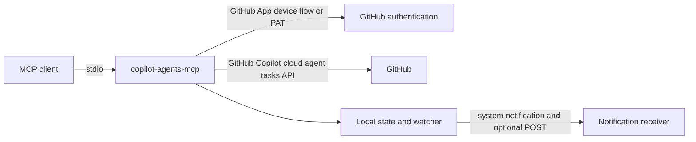

<p align="center">
  
</p>

# copilot-agents-mcp

`copilot-agents-mcp` is a local Model Context Protocol (MCP) server for launching and managing GitHub Copilot cloud agent tasks.
It runs on your machine over stdio or local HTTP. Requires Node.js 26 or later.



## Install

**Requirement:** Node.js 26 or later.

The published package is [`copilot-agents-mcp`](https://www.npmjs.com/package/copilot-agents-mcp) on npm (`copilot-agents-mcp` on your `PATH` when installed).

### Sign in with the GitHub App (preferred)

```bash
npx -y copilot-agents-mcp login
npx -y copilot-agents-mcp auth status
```

Complete the device flow in your browser. `auth status` reports the active credential and does not print tokens. See [authentication](https://github.com/daniel-saezv/copilot-agents-mcp/blob/main/docs/authentication.md) and [permissions](https://github.com/daniel-saezv/copilot-agents-mcp/blob/main/docs/permissions.md).

### Alternative: personal access token

Set `GITHUB_PERSONAL_ACCESS_TOKEN` in the environment of the MCP server process: export it in the shell that starts the client, or set it only in **user-level** (not project) client configuration. Never put tokens in project files such as `.cursor/mcp.json` or `.vscode/mcp.json` that may be committed. Prefer GitHub App `login` when the system keyring is available.

### MCP configuration

Use this stdio server entry everywhere:

```json
{
  "command": "npx",
  "args": ["-y", "copilot-agents-mcp"]
}
```

| Client | Where to put it |
| --- | --- |
| **Visual Studio Code** | `.vscode/mcp.json` → `servers.copilot-agents` with `"type": "stdio"` plus the fields above (no tokens in the repo copy) |
| **Claude Desktop** | User-level `claude_desktop_config.json` → `mcpServers.copilot-agents` |
| **Claude Code** | `claude mcp add --transport stdio copilot-agents -- npx -y copilot-agents-mcp`. For a PAT, add `-e GITHUB_PERSONAL_ACCESS_TOKEN=…` (stored in your private `~/.claude.json`) |
| **Cursor** | `~/.cursor/mcp.json` (global) or `.cursor/mcp.json` (project; no tokens) |
| **Grok Bot** | Add a local stdio MCP server with the command and args above. |

Local HTTP (optional):

```bash
npx -y copilot-agents-mcp --http --port 3333
```

The endpoint is `http://127.0.0.1:3333/mcp`.

You can also ask your agent (Cursor, Claude Code, Grok Bot, etc.) to wire it up. Example prompt:

```text
Add the copilot-agents MCP server with command npx and args -y copilot-agents-mcp. Prefer GitHub App login over a PAT.
```

## Tools

<!-- START AUTOMATED TOOLS -->
| Tool | Toolset | Read-only | Description |
| --- | --- | --- | --- |
| `create_agent_task` | copilot_tasks | no | Launch a GitHub Copilot cloud agent task. The model is sent unchanged. If the model was already rejected, the tool skips the API call and lists accepted models observed so far. |
| `get_agent_task` | copilot_tasks | yes | Read a GitHub Copilot agent task once. |
| `steer_agent_task` | copilot_tasks | no | [Experimental] Undocumented internal GitHub endpoint that can change without notice. Each steer consumes credits. The agent applies the instruction after its current tool call finishes. Send an instruction to a task with an open pull request. |
| `abort_agent_task` | copilot_tasks | no | [Experimental] Undocumented internal GitHub endpoint that can change without notice. Send {type: "abort"} to the steer endpoint, as VS Code does in tasksClient.ts, to stop the task. This has not been verified against GitHub. |
| `get_agent_task_events` | copilot_tasks | yes | [Experimental] Undocumented internal GitHub endpoint that can change without notice. Read one page of task events (read-only). |
| `list_copilot_models` | copilot_models | yes | Read /agents/swe/models and return the ID, name, vendor, preview flag, token prices or multiplier, and promotion when present. |
<!-- END AUTOMATED TOOLS -->

See [the tool reference](https://github.com/daniel-saezv/copilot-agents-mcp/blob/main/docs/tools.md) for all input and output fields.

## Watch tasks

`create_agent_task` starts a detached watcher. You can also start it directly:

```bash
npx -y copilot-agents-mcp watch
```

The watcher polls pending tasks, stores local state, and sends completion notifications. See [notifications](https://github.com/daniel-saezv/copilot-agents-mcp/blob/main/docs/notifications.md).

## Release

Push a tag `vMAJOR.MINOR.PATCH`. The release workflow checks that the tag (without the leading `v`) matches `version` in `package.json`, then runs typecheck, lint, tests, build, and a package smoke test on Node 26. The `publish` job stages the version on npm with `npm stage publish --provenance --access public` using [OIDC trusted publishing](https://docs.npmjs.com/trusted-publishers/) (no npm tokens). The maintainer (Gamusino) approves each staged release on [npmjs.com](https://www.npmjs.com/) with 2FA before it becomes the live version.

## Test and build

```bash
bash scripts/setup
npm test
npm run typecheck
npm run lint
npm run build
node scripts/pack-smoke.mjs
```

Agent development instructions remain in [AGENTS.md](https://github.com/daniel-saezv/copilot-agents-mcp/blob/main/AGENTS.md).

## License

[MIT](https://github.com/daniel-saezv/copilot-agents-mcp/blob/main/LICENSE)
