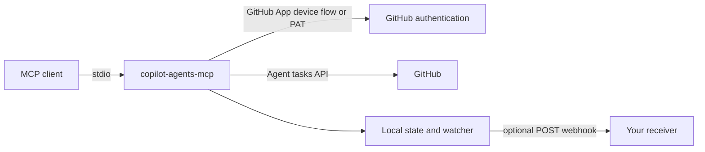

<p align="center">
  
</p>

# copilot-agents-mcp

Local [Model Context Protocol](https://modelcontextprotocol.io/) server for launching and managing GitHub Copilot **cloud agent** tasks. It speaks MCP over **stdio only** and runs on your machine (Node.js **26+**).



## Requirements

- **Node.js 26** or later (`engines.node` in `package.json`).
- GitHub credentials: GitHub App **login** (preferred) or `GITHUB_PERSONAL_ACCESS_TOKEN`.

## Authentication

```bash
npx -y github:daniel-saezv/copilot-agents-mcp login
npx -y github:daniel-saezv/copilot-agents-mcp auth status
```

Complete the device flow in the browser. `auth status` shows the active credential without printing tokens. Alternatively set `GITHUB_PERSONAL_ACCESS_TOKEN` in the MCP server process environment (never commit tokens in project config).

Optional: `COPILOT_AGENTS_GITHUB_APP_CLIENT_ID`, `COPILOT_AGENTS_GITHUB_API_BASE_URL` (GitHub Enterprise).

## Environment variables

| Variable | Purpose |
| --- | --- |
| `GITHUB_PERSONAL_ACCESS_TOKEN` | PAT; takes precedence over keyring session |
| `COPILOT_AGENTS_NOTIFY_URL` | Webhook URL; watcher POSTs JSON when a task finishes |
| `COPILOT_AGENTS_NOTIFY_AUTHORIZATION` | Sent verbatim as the `Authorization` header on that POST (e.g. `Bearer <routine-key>`) |
| `COPILOT_AGENTS_STATE_PATH` | Isolated state file (default `~/.copilot-agents-mcp/state.json`) |
| `COPILOT_AGENTS_LOG` | Optional watcher log file |
| `COPILOT_AGENTS_GITHUB_API_BASE_URL` | Enterprise API base |

Watcher poll interval and task freshness are **fixed internally** (15s poll, 60s freshness).

## Tools

<!-- START AUTOMATED TOOLS -->
| Tool | Read-only | Description |
| --- | --- | --- |
| `create_agent_task` | no | Launch a GitHub Copilot cloud agent task. The model is sent unchanged. If the model was already rejected, the tool skips the API call and lists accepted models observed so far. Returns immediately with task_id. Pass owner=<your agent name> unless this server runs a single agent. Follow next_step. |
| `get_agent_task` | yes | Read one task once. Returns status, terminal and a one-line summary. Do not call repeatedly; use list_agent_tasks for periodic checks. |
| `list_agent_tasks` | yes | One call to check all tracked tasks. Use it for scheduled checks. When all_terminal is true, stop checking. Several agents may share this server; owner is a labeling convention, not a security boundary. |
| `steer_agent_task` | no | [Experimental] Undocumented internal GitHub endpoint that can change without notice. Each steer consumes credits. The agent applies the instruction after its current tool call finishes. Send an instruction to a task with an open pull request. |
| `abort_agent_task` | no | [Experimental] Undocumented internal GitHub endpoint that can change without notice. Send {type: "abort"} to the steer endpoint, as VS Code does in tasksClient.ts, to stop the task. This has not been verified against GitHub. |
| `list_copilot_models` | yes | Read /agents/swe/models and return the ID, name, vendor, preview flag, token prices or multiplier, and promotion when present. |
<!-- END AUTOMATED TOOLS -->

After `create_agent_task`, end your turn. The server returns `follow_up` and `next_step`: either wake on a webhook or schedule `list_agent_tasks` (not before `check_after`).

## Client setup

Run the same stdio command everywhere:

```json
{
  "command": "npx",
  "args": ["-y", "github:daniel-saezv/copilot-agents-mcp"]
}
```

### (a) Grok Bot

1. Add a **local stdio MCP server** with the command and args above.
2. Optional: set `COPILOT_AGENTS_STATE_PATH` in the server environment so this bot does not share state with other agents.
3. **Webhook routine (recommended):** In Grok Bot, create a **Routine** with a **Webhook** trigger and copy its URL and key.
4. In the MCP server env, set `COPILOT_AGENTS_NOTIFY_URL` to that URL and `COPILOT_AGENTS_NOTIFY_AUTHORIZATION` to `Bearer <routine-key>` (include `Bearer ` exactly once).
5. When a Copilot task reaches a terminal state, the background watcher POSTs JSON to the routine; the bot can wake and call `get_agent_task` once. Without the webhook, follow the `check_later` text in `next_step`.

### (b) Claude Code and Claude Desktop

**Claude Code:**

```bash
claude mcp add --transport stdio copilot-agents -- npx -y github:daniel-saezv/copilot-agents-mcp
```

For a PAT: add `-e GITHUB_PERSONAL_ACCESS_TOKEN=…` (stored in your private `~/.claude.json`).

**Claude Desktop:** user-level `claude_desktop_config.json`:

```json
{
  "mcpServers": {
    "copilot-agents": {
      "command": "npx",
      "args": ["-y", "github:daniel-saezv/copilot-agents-mcp"]
    }
  }
}
```

### (c) Cursor

`~/.cursor/mcp.json` (global) or project `.cursor/mcp.json` (no secrets in committed project files):

```json
{
  "mcpServers": {
    "copilot-agents": {
      "command": "npx",
      "args": ["-y", "github:daniel-saezv/copilot-agents-mcp"]
    }
  }
}
```

### (d) Generic `npx` / any MCP client

Point stdio transport at `npx -y github:daniel-saezv/copilot-agents-mcp`. Pass auth and notification env vars in the client’s server environment.

## Watch tasks

```bash
npx -y github:daniel-saezv/copilot-agents-mcp watch
```

`create_agent_task` also starts a detached watcher when `COPILOT_AGENTS_NOTIFY_URL` is set. The watcher polls pending tasks, updates local state under a directory lock, and POSTs completion notices once per terminal state.

Several agents can share one server; pass a stable `owner` on create and filter with `list_agent_tasks` (labeling convention, not a security boundary).

## Develop

```bash
bash scripts/setup
npm test
npm run typecheck
npm run lint
npm run build
```

See [AGENTS.md](AGENTS.md) for agent maintenance notes.

## License

[MIT](LICENSE)