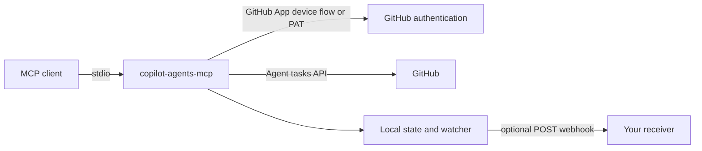

<p align="center">
  
</p>

# copilot-agents-mcp

Local [Model Context Protocol](https://modelcontextprotocol.io/) server for launching and managing GitHub Copilot **cloud agent** tasks. It speaks MCP over **stdio only** and runs on your machine (Node.js **26+**).



## Requirements

- **Node.js 26** or later (`engines.node` in `package.json`).
- GitHub credentials: GitHub App **login** (preferred) or `GITHUB_PERSONAL_ACCESS_TOKEN`.

## Authentication

```bash
npx -y github:daniel-saezv/copilot-agents-mcp login
npx -y github:daniel-saezv/copilot-agents-mcp auth status
```

Complete the device flow in the browser. `auth status` shows the active credential without printing tokens, then **local diagnostics** (no network, never reading notify secret values): state file and lock directory writability (non-writable → exit code 1); webhook env set yes/no only (both unset → info: optional; exactly one set → warning); `DBUS_SESSION_BUS_ADDRESS` yes/no plus an info line on Linux when unset. Optional webhook and notify warnings do not change the exit code. Alternatively set `GITHUB_PERSONAL_ACCESS_TOKEN` in the MCP server process environment (never commit tokens in project config).

Optional: `COPILOT_AGENTS_GITHUB_APP_CLIENT_ID`, `COPILOT_AGENTS_GITHUB_API_BASE_URL` (GitHub Enterprise).

## Environment variables

| Variable | Purpose |
| --- | --- |
| `GITHUB_PERSONAL_ACCESS_TOKEN` | PAT; takes precedence over keyring session |
| `COPILOT_AGENTS_NOTIFY_URL` | Webhook URL; watcher POSTs JSON when a task finishes |
| `COPILOT_AGENTS_NOTIFY_AUTHORIZATION` | Literal `Authorization` header on the notify POST: `Bearer <routine-key>` (not the webhook URL) |
| `COPILOT_AGENTS_STATE_PATH` | Isolated state file (default `~/.copilot-agents-mcp/state.json`) |
| `COPILOT_AGENTS_LOG` | Optional watcher log file |
| `COPILOT_AGENTS_GITHUB_API_BASE_URL` | Enterprise API base |
| `DBUS_SESSION_BUS_ADDRESS` | On headless Linux, points the OS keyring (`secret-service`) at the session bus (e.g. `unix:path=/tmp/xdg-runtime-box/bus` on a Grok Bot box). If unset and login fails, use `GITHUB_PERSONAL_ACCESS_TOKEN` instead |

Watcher poll interval and task freshness are **fixed internally** (15s poll, 60s freshness).

## Tools

<!-- START AUTOMATED TOOLS -->
| Tool | Read-only | Description |
| --- | --- | --- |
| `create_agent_task` | no | Launch a GitHub Copilot cloud agent with repo, prompt, and model; use list_copilot_models to discover IDs. Returns status, delivery, follow_up, and next_step. May fail for authentication, repository access or policy, invalid input, or an unavailable model; previously rejected models skip the API and list accepted models observed so far. Returns immediately with task_id. Pass owner=<your agent name> unless this server runs a single agent. Follow next_step. |
| `get_agent_task` | yes | Read one task's result by task_id; optional repo overrides the saved repository and verbose adds details. Returns status, terminal, summary, delivery, and available PR/session links. Cached results may include stale and warnings after a refresh failure. Check authentication or task/repository access on errors. Use list_agent_tasks for scheduled checks, never call this in a loop. |
| `list_agent_tasks` | yes | Check locally tracked tasks in one scheduled call, filtered by owner, task_ids, status, or repo. Returns compact rows (limit defaults to 20, maximum 50), counts across all matches, all_terminal, next_step, and next_check_after while pending. Stop checks when all_terminal is true. Refresh failures return stale rows and warnings; pending tasks require authentication. Owner is a label, not a security boundary; this is not a GitHub-wide task search. |
| `steer_agent_task` | no | [Experimental] Undocumented internal GitHub endpoint that can change without notice. Send content to task_id when continuing or redirecting a task with an open pull request. Each call consumes credits and is not idempotent; the agent applies it after its current tool call. Returns task_id, accepted, and the pre-steer session_count, then watches the new turn when notifications are configured. Errors explain missing authentication, repository, or an absent/closed pull request. |
| `abort_agent_task` | no | [Experimental] Undocumented internal GitHub endpoint that can change without notice. Request cancellation of task_id via the internal steer endpoint; not verified against live GitHub. Use only to stop work, not to read status. Returns accepted, status, and terminal; accepted=false with reason when already finished. Acceptance does not mean cancellation has completed. Check authentication and task access on errors. |
| `list_copilot_models` | yes | Discover model IDs before create_agent_task. Reads /agents/swe/models and returns source metadata plus models with ID, name, vendor, preview, token prices or billing multiplier, and optional promotion/policy. No parameters. Availability remains subject to repository policy. Errors explain missing authentication, upstream access/network failures, or an invalid upstream response. |
<!-- END AUTOMATED TOOLS -->

After `create_agent_task`, end your turn. The server returns `follow_up` and `next_step`: either wake on a webhook or schedule `list_agent_tasks` (not before `check_after`).

Version **0.2.0** preserves the six tool names, inputs, and JSON text responses from 0.1.0. Every tool now advertises an output schema and returns matching `structuredContent`. See [tool contracts and error codes](docs/tools.md).

## Client setup

Run the same stdio command everywhere:

```json
{
  "command": "npx",
  "args": ["-y", "github:daniel-saezv/copilot-agents-mcp"]
}
```

### (a) Grok Bot

1. Add a **local stdio MCP server** with the command and args above.
2. Optional: set `COPILOT_AGENTS_STATE_PATH` in the server environment so this bot does not share state with other agents.
3. On headless Linux, set `DBUS_SESSION_BUS_ADDRESS` (for example `unix:path=/tmp/xdg-runtime-box/bus`) so GitHub App `login` can use the keyring; otherwise set `GITHUB_PERSONAL_ACCESS_TOKEN` in the server env.
4. **Webhook routine (recommended):** Create a **Routine** with a **Webhook** trigger in the Grok Bot UI. The **human who owns the routine** configures the MCP server’s masked secret fields; the bot cannot read those values itself. Set `COPILOT_AGENTS_NOTIFY_URL` to the routine’s **webhook URL** from the panel (`https://…`).
5. Set `COPILOT_AGENTS_NOTIFY_AUTHORIZATION` to the literal string `Bearer <routine-key>`: the word `Bearer` exactly once, one space, then the routine’s **Authorization key** from the panel. The server sends this value verbatim as the HTTP `Authorization` header. Do **not** paste the webhook URL here—that belongs only in `COPILOT_AGENTS_NOTIFY_URL`.
6. When a Copilot task reaches a terminal state, the background watcher POSTs JSON to the routine; the bot can wake and call `get_agent_task` once. Without the webhook, follow the `check_later` text in `next_step`.

### (b) Claude Code and Claude Desktop

**Claude Code:**

```bash
claude mcp add --transport stdio copilot-agents -- npx -y github:daniel-saezv/copilot-agents-mcp
```

For a PAT: add `-e GITHUB_PERSONAL_ACCESS_TOKEN=…` (stored in your private `~/.claude.json`).

**Claude Desktop:** user-level `claude_desktop_config.json`:

```json
{
  "mcpServers": {
    "copilot-agents": {
      "command": "npx",
      "args": ["-y", "github:daniel-saezv/copilot-agents-mcp"]
    }
  }
}
```

### (c) Cursor

`~/.cursor/mcp.json` (global) or project `.cursor/mcp.json` (no secrets in committed project files):

```json
{
  "mcpServers": {
    "copilot-agents": {
      "command": "npx",
      "args": ["-y", "github:daniel-saezv/copilot-agents-mcp"]
    }
  }
}
```

### (d) Generic `npx` / any MCP client

Point stdio transport at `npx -y github:daniel-saezv/copilot-agents-mcp`. Pass auth and notification env vars in the client’s server environment.

## Watch tasks

```bash
npx -y github:daniel-saezv/copilot-agents-mcp watch
```

`create_agent_task` also starts a detached watcher when an eligible owner webhook or `COPILOT_AGENTS_NOTIFY_URL` is configured. The watcher polls pending tasks, updates local state under a directory lock, and records completion delivery.

Several agents can share one server; pass a stable `owner` on create and filter with `list_agent_tasks` (labeling convention, not a security boundary).

## Optional per-client webhooks

A webhook is the **RECOMMENDED** completion path. Clients that can receive webhooks should register one from the start with `webhook register`. `check_later` is the supported fallback: end the turn, schedule a check at `check_after` if possible, never poll in a loop. Webhook registration is local CLI configuration, not an MCP tool:

```bash
copilot-agents-mcp webhook register --owner client-1
copilot-agents-mcp webhook list
copilot-agents-mcp auth status
copilot-agents-mcp webhook remove --owner client-1
```

Registration reads the URL and complete `Authorization` header value through hidden terminal prompts. Alternatively, supply private input files with `--url-file /path/to/url-file --auth-file /path/to/auth-file`. Never put either secret in argv, environment variables for this command, or chat. Keep input files private and remove them when no longer needed.

Use the same `owner` when calling `create_agent_task`. Owners are exact, case-sensitive routing labels, **not authentication**: any local process with state access can register any owner. All clients and the watcher must share `COPILOT_AGENTS_STATE_PATH` (default `~/.copilot-agents-mcp/state.json`).

For an owner without a registration, only the creation response adds: “No webhook: using check_later. Recommended: configure one with `webhook register`.” It never blocks creation or repeats on status checks.

The registry stores the URL, registration time, and key file path in locked local state; the Authorization value lives separately in a mode `0600` file named `sha256(owner)` beside that state. `webhook list` shows only owner, URL host, key path, and registration time. `auth status` reports owner, host, and key presence/permissions, never the URL path/query or Authorization value.

Only tasks created **after** registration route to that owner. Other tasks retain the existing global `COPILOT_AGENTS_NOTIFY_URL` / `COPILOT_AGENTS_NOTIFY_AUTHORIZATION` fallback. Failed owner delivery does not forward secrets or task data to the global endpoint. Re-registration applies only to subsequent tasks.

Owner endpoints must use public HTTPS. Registration and delivery validate every resolved IP, blocking local/private, CGNAT, link-local, metadata, unspecified, multicast, and broadcast destinations, including IPv4-mapped IPv6. Delivery pins a validated address while retaining the original TLS hostname, preventing DNS rebinding; redirects fail. `COPILOT_AGENTS_NOTIFY_ALLOWED_HOSTS` optionally narrows allowed hostnames (comma-separated); it never permits blocked IPs. Unset means any public HTTPS host.

Owner and global POST bodies contain only `task_id`, `state`, `repo`, and `pr_url` (nullable), with a stable `Idempotency-Key: <task_id>:<status>` per task and terminal status. Receivers should deduplicate this key and call `get_agent_task` for details. Delivery records remain in local state; inspect `get_agent_task.delivery` and use scheduled checks if delivery fails.

If the receiver uses a private CA, set `NODE_EXTRA_CA_CERTS=/path/to/ca.pem` before starting the server/watcher process that sends webhooks. Setting it only on the receiver does not configure the sender's trust.

### Example client: Grok Bot routine

1. Each bot creates its own webhook-trigger routine.
2. The owner copies that routine's URL and complete Authorization value into the hidden prompts of `copilot-agents-mcp webhook register --owner <botName>`. Never paste either into chat.
3. Have that bot launch a tiny task with `owner: "<botName>"`, such as a one-line documentation correction.
4. Verify end-to-end that its routine receives the terminal notice and calls `get_agent_task` once for the result. Confirm another bot's routine is not triggered. No release or merge is needed.

## Develop

```bash
bash scripts/setup
npm test
npm run typecheck
npm run lint
npm run build
```

See [AGENTS.md](AGENTS.md) for agent maintenance notes.

## License

[MIT](LICENSE)